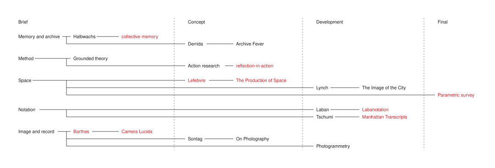

# lineage-tree

Draw the intellectual lineage of a design project as a single SVG: which thinkers, works and
precedents came in at which stage, which ones branched, and which ones lasted to the end.



The example ([`example/sample.md`](example/sample.md)) is a made-up research project, ordered
with `--order axis --axis axes/ddc.txt`.

## Reading the drawing

- **Left to right is time.** Each dashed column is a stage of the project (a *cohort*). A label
  sits in the stage where it first appeared.
- **Inside a stage, left to right is hierarchy:** lineage › name › concept. A branch that crosses
  a dashed line is something that picked up a new part later.
- **Top to bottom is a spectrum.** Lineages are ordered so that each one sits next to the
  lineages it shares names with; the page reads as one continuous gradient of kinship rather
  than a stack of separate boxes.
- **Red** labels lasted to the end of the project.

The layout follows four rules: every leaf gets its own row, one font at one size, one padding
value between any text and any line end, and no boxes around text.

## Usage

Needs Python 3.8+. No other dependency; install Pillow only if you want exact label widths from a
font file.

```
python3 lineage_tree.py outline.md                 # writes outline.svg
python3 lineage_tree.py outline.md -o lineage.svg
python3 lineage_tree.py outline.md --order axis --axis axes/ddc.txt   # by class= on an axis
python3 lineage_tree.py outline.md --order auto    # order lineages by shared also= names
python3 lineage_tree.py outline.md --order semantic   # also= names first, then meaning (needs Ollama)
```

For exact widths, set `font_file` in `STYLE` at the top of the script to the font you will
typeset with (and `pip install pillow`). Without it, widths are estimated per character, CJK
counted as full width.

## Outline format

```
> one @cohort line per stage, in order; one # line per lineage
@cohort Start
@cohort Concept

# Archive and truth
## Sekula | Start | also=Photography
- The Body and the Archive | Start | keep
## Foucault | Concept
> notes start with > and are ignored

# Photography
## Barthes | Concept | keep
```

- `## name | stage | flags` is a name; it may have concepts under it or stand alone.
- `### name | stage | flags` is a name that continues from the `##` name above it.
- `- concept | stage | flags` is a concept under the nearest name.
- `@top TEXT` and `@bottom TEXT` (optional) name what the two ends of the spectrum are about;
  `--order semantic` uses them to decide which way up the page reads.
- Flags: `keep` (lasted to the end, drawn red), `also=Other lineage` (also belongs to that
  lineage), `class=CODE` (position on an ordering axis, see below).
- A child cannot be earlier than its parent. Inside a lineage, names are ordered by stage, then
  by their order in the file.

All spacing, colours and dash patterns are in the `STYLE` dict at the top of the script.
`show_also=True` draws a dashed guide line for each `also=` name between neighbouring lineages.

## Making an outline: the questionnaire

[`questionnaire.md`](questionnaire.md) is a fill-in template that walks through stages, names,
concepts, lineages and order, one table each, and maps every answer to an outline line.

## Ordering the lineages

Top to bottom is meant to read as one continuous spectrum, and the order should come from a rule,
not from re-arranging by hand each time. Four orders are built in:

- `--order file` (default): as written.
- `--order axis --axis FILE`: by a classification read as a line. The axis is a text file, one
  class per line, in order; the tool itself ships no classification. Tag any line with
  `class=`; a lineage sits at the median position of the classes on it and under it, and
  lineages without any class go last. If the axis lines start with numbers, numeric codes are
  placed by value between them, so `class=720.9` keeps its place inside `700`.
  [`axes/`](axes/) has two examples: Dewey Decimal main classes and the four categories of the
  Warburg Institute Library (Image, Word, Orientation, Action). Write your own for any typology.
- `--order auto`: by shared names. Lineages whose names carry `also=` tags pointing at each other
  are put next to each other; among equally good orders the one closest to the file order wins,
  so lineages with no shared names stay where they are.

- `--order semantic`: constrained seriation. Seriation is the archaeologist's problem of putting
  finds in a sequence from their likeness alone (Flinders Petrie used it to order Egyptian
  graves, 1899); here the finds are lineages. `also=` links come first and are never broken:
  lineages that share names stay together. The remaining freedom is settled by meaning: each
  lineage is embedded as its label plus every name under it, and among all orders that keep the
  links, the one whose neighbours are most alike wins (exhaustive up to 9 lineages). A chain of
  likeness has no direction, so the end closer to `@top` goes on top (or, without anchors, the
  end holding the file's first lineage). The output also prints the two runners-up and how much
  less alike their neighbours are, so a close call is visible. Needs a local
  [Ollama](https://ollama.com) server; the default model is `qwen3-embedding:4b`
  (`--model`, `--ollama` to change). Use `--order axis` as well when you want a classification
  to have the last word.

Which lineage a name belongs to stays a judgement. The questionnaire gives one test for it:
*what question was I asking when I picked this up?*

## License

MIT
