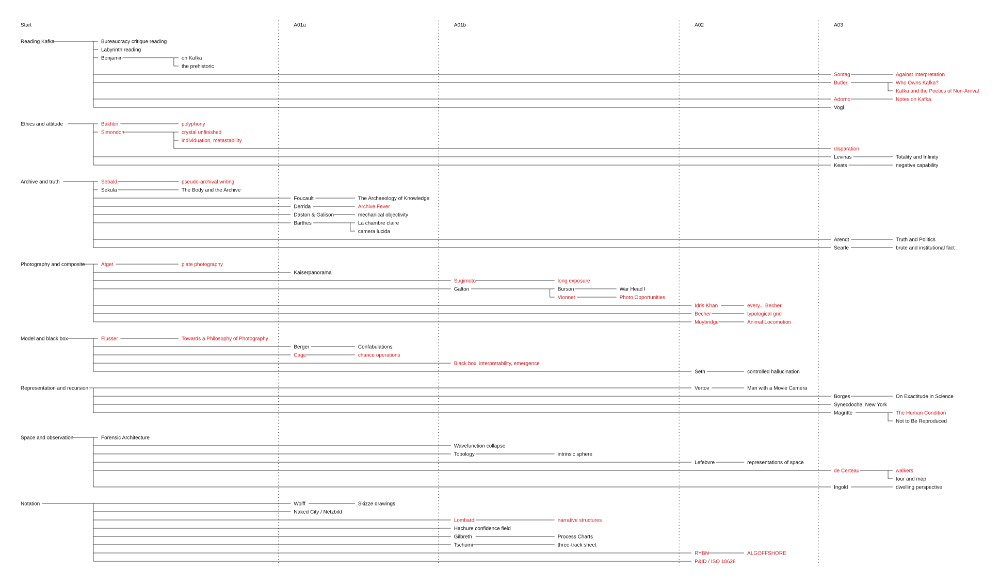

# lineage-tree

Draw the intellectual lineage of a design project as a single SVG: which thinkers, works and
precedents came in at which stage, which ones branched, and which ones lasted to the end.



The example is the lineage of *File Under Castle*, an architecture studio project on Kafka's
*The Castle* (University of Sydney, 2026).

## Reading the drawing

- **Left to right is time.** Each dashed column is a stage of the project (a *cohort*). A label
  sits in the stage where it first appeared.
- **Inside a stage, left to right is hierarchy:** lineage › name › concept. A branch that crosses
  a dashed line is something that picked up a new part later.
- **Top to bottom is a spectrum.** Lineages are ordered so that each one sits next to the
  lineages it shares names with; the page reads as one continuous gradient of kinship rather
  than a stack of separate boxes.
- **Red** labels lasted to the end of the project.

The layout follows four rules: every leaf gets its own row, one font at one size, one padding
value between any text and any line end, and no boxes around text.

## Usage

Needs Python 3.8+. No other dependency; install Pillow only if you want exact label widths from a
font file.

```
python3 lineage_tree.py outline.md                 # writes outline.svg
python3 lineage_tree.py outline.md -o lineage.svg
python3 lineage_tree.py outline.md --order auto    # reorder lineages into a spectrum
```

For exact widths, set `font_file` in `STYLE` at the top of the script to the font you will
typeset with (and `pip install pillow`). Without it, widths are estimated per character, CJK
counted as full width.

## Outline format

```
> one @cohort line per stage, in order; one # line per lineage
@cohort Start
@cohort A01

# Archive and truth
## Sekula | Start | also=Photography
- The Body and the Archive | Start | keep
## Foucault | A01
> notes start with > and are ignored

# Photography
## Barthes | A01 | keep
```

- `## name | stage | flags` is a name; it may have concepts under it or stand alone.
- `### name | stage | flags` is a name that continues from the `##` name above it.
- `- concept | stage | flags` is a concept under the nearest name.
- Flags: `keep` (lasted to the end, drawn red), `also=Other lineage` (also belongs to that
  lineage).
- A child cannot be earlier than its parent. Inside a lineage, names are ordered by stage, then
  by their order in the file.

All spacing, colours and dash patterns are in the `STYLE` dict at the top of the script.
`show_also=True` draws a dashed guide line for each `also=` name between neighbouring lineages.

## Making an outline: the questionnaire

[`questionnaire.md`](questionnaire.md) is a fill-in template that walks through stages, names,
concepts, lineages and order, one table each, and maps every answer to an outline line.

## Sorting names into lineages

Lineages are themes, and deciding them is a design judgement, so the tool does not guess them. The
questionnaire gives one test to apply name by name: *what question was I asking when I picked this
up?* Names picked up while asking the same question share a lineage, named after that question.
When a name was picked up for one question but ended up answering another, tag it
`also=` that other lineage.

Those `also=` tags are what `--order auto` uses. It tries every order of the lineages (up to
nine; a greedy chain above that) and keeps the one where neighbouring lineages share the most
names; among equal orders it keeps the one closest to the order in the file. Lineages that
share no names with any other stay where you put them, so the more `also=` tags the outline
has, the more of the spectrum is computed rather than hand-placed.

On the example, `--order auto` returns the hand-made order unchanged. With the lineages shuffled,
it rebuilds the Ethics, Archive, Photography and Model chain from the shared names; the lineages
with no shared names stay where they were in the shuffled file.

## License

MIT
